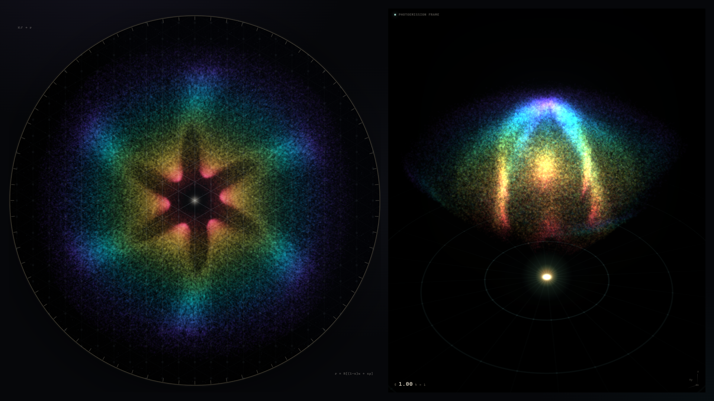
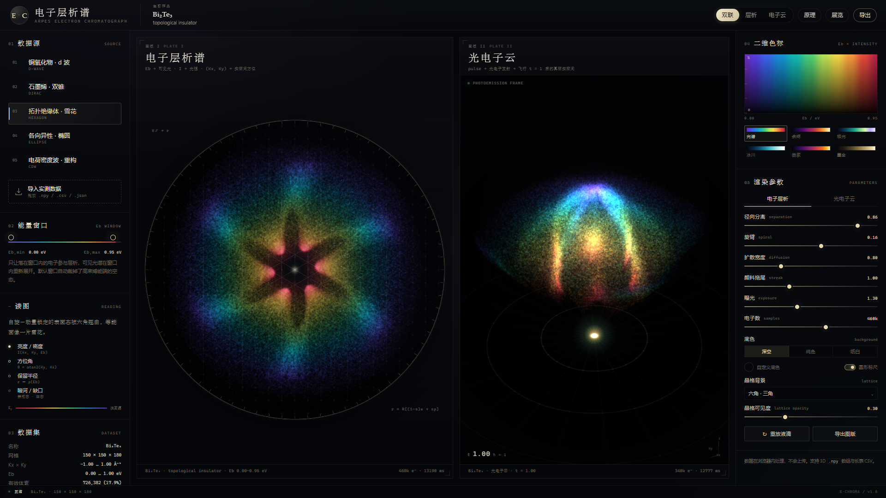
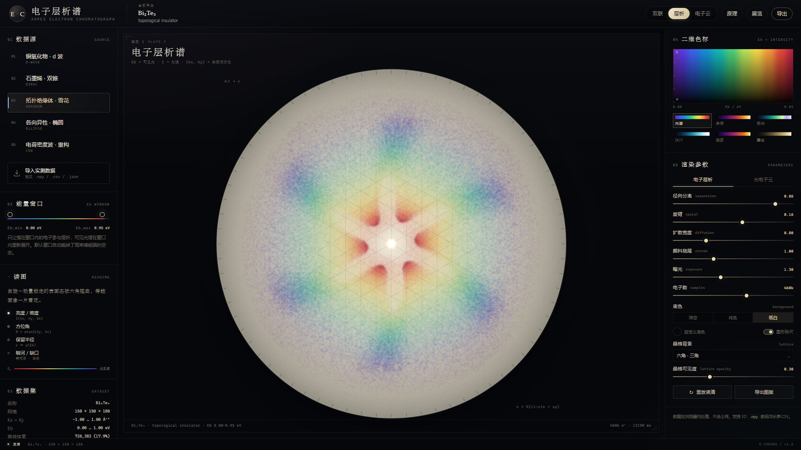

# E·CHROMA · 电子层析谱

> 把 ARPES 的三维能谱 I(Kx, Ky, Eb)，展开成一张实空间中的电子层析谱，以及一团超快光电子云。



| 深空模式 · 双联视图 | 纸白模式 · 层析图版 |
| --- | --- |
|  |  |

E·CHROMA 是一个面向 ARPES（角分辨光电子能谱）Mapping 数据的科学可视化程序。它把能量轴当作颜料、把面内动量当作方位，将三维强度体数据投影到一张圆形的“层析纸”上；同时提供一版三维光电子飞行快照，把同一份数据变成真空中发光的电子云。

程序完全在浏览器里运行，不上传数据。内置五个合成样品用于演示与调参，也可以直接导入实测的 `.npy`、`.csv`、`.json` 数据。

---

## 快速开始

需要 Node.js 18 或更高版本。

```bash
npm install
npm run dev
```

打开终端里显示的地址（默认 <http://127.0.0.1:5173>）。

生成生产版本：

```bash
npm run build
npm run preview
```

推荐使用 1440 px 以上宽度的窗口；在 1920 × 1080 下可以获得最完整的双联图版。

---

## 两种图景

### 图版 I · 电子层析谱

把整个能量窗口线性映射到可见光谱，把每个电子从注入点向外“展开”：

```text
ε  = (Eb − E0) / (E1 − E0)                 归一化结合能
ρ  = 0.04 + 0.87 · (1 − ε)^1.15            能量保留距离
κ  = |(Kx, Ky)| / Kmax                      归一化动量大小
θ  = atan2(Ky, Kx) + τ · (ε − 0.45)         方位角 + 旋臂
r  = R · [ s·ρ + (1 − s) · (0.16 + 0.84·κ) ] 实空间半径
```

- `s` 是“径向分离”滑杆：`s = 1` 时是完全按能量分层的彩虹环，`s = 0` 时是纯粹的动量投影。
- 颜色只由 `ε` 决定；在该能量窗口内重新铺满色标。
- `I(Kx, Ky, Eb)` 被编码为点的密度、透明度与尺寸。没有谱权重的地方自然留下暗河与缺口。
- 图像边界固定为圆形；超出边界的点被压回圆内，保证所有电子都收在画面里。
- 默认能量窗口会按强度加权分位数自动裁掉高束缚能端的空态，之后可以手动拖动窗口。

### 图版 II · 光电子云

三维图景改为泵浦—探测：一束超短脉冲把电子从样品表面打出，光电子在真空中自由飞行 `t = 1` 后成像。

```text
v ∝ √(1 − 0.88·ε)          动能越大，飞得越远
α = αmax · κ                面内动量越大，发射角越大
r = v · t                   真空中的飞行距离
```

每一层能量是一个发光的球冠；所有球冠叠在一起，就是三维电子云。六角翘曲、四重节点、双狄拉克锥等结构会直接长成电子云表面的花瓣、支柱和缺口。

`t` 变化时，相机会自动重新取景，保证整团电子都在窗口里；也可以直接用鼠标拖拽、滚轮缩放。

---

## 数据导入

### 1. NumPy `.npy`（推荐）

支持三维 `float32 / float64 / int` 数组，C 序与 Fortran 序都可以。导入时会弹出对话框，选择轴顺序并填写坐标范围：

| 轴顺序 | 数组形状 |
| --- | --- |
| `Eb · Ky · Kx`（常见） | `(nE, nKy, nKx)` |
| `Kx · Ky · Eb` | `(nKx, nKy, nE)` |
| `Ky · Kx · Eb` | `(nKy, nKx, nE)` |

Python 示例：

```python
import numpy as np

# I[e, y, x]，float32；Eb 从 0 到 0.9 eV，Kx/Ky 从 -1 到 1
np.save("my_arpes.npy", I.astype(np.float32))
```

> `.npy` 本身不携带物理坐标，只有数组形状。**务必在导入对话框中填写真实的 Kx、Ky、Eb 范围**，否则色标与能量窗口会失真。缺失体素按 0 处理。

### 2. 长表 CSV

支持带表头的 CSV / TSV，一行一个体素：

```csv
kx,ky,eb,intensity
-1.0000,-1.0000,0.0000,0.0012
-0.9875,-1.0000,0.0000,0.0014
...
```

- 列名可以是 `kx, ky, eb, intensity`，也接受 `Kx, Ky, energy, counts` 等常见写法。
- 坐标轴会从数据中自动推断；数据不必填满整个长方体。
- 文件较大时建议改用 `.npy`。

### 3. JSON

```json
{
  "kx": [-1.0, -0.99, "..."],
  "ky": [-1.0, -0.99, "..."],
  "eb": [0.0, 0.01, "..."],
  "intensity": [0.001, 0.002, "..."]
}
```

`intensity` 是按 `[Eb][Ky][Kx]` 展开的一维数组，也接受同形状的三层嵌套数组。

### 归一化

读入后会对强度做稳健归一化（2%–99.6% 分位裁剪），避免单个热点毁掉对比度。`I` 在采样时按 `I^0.82` 做重要性采样，因此亮态会获得更多电子点。

---

## 操作说明

### 数据与能量窗口

- 左侧五个预设：d 波铜氧化物、石墨烯双狄拉克锥、拓扑绝缘体六角翘曲、各向异性椭圆费米面、CDW 重构。
- “导入实测数据”支持拖放。
- 能量窗口用双滑块控制；颜色会在窗口内重新展开。窗口越窄，某一能量区间的结构被放得越大。

### 层析渲染

| 控件 | 作用 |
| --- | --- |
| 径向分离 | 能量分层 ↔ 动量投影 |
| 旋臂 | 不同能量的方位角轻微错开，形成螺旋 |
| 扩散宽度 | 径向抖动，模拟层析扩散 |
| 颜料拖尾 | 每个电子点的径向拉长程度 |
| 曝光 | 叠加亮度 |
| 电子数 | 采样点数（8 万–70 万） |
| 底色 | 深空 / 纯色 / 纸白；纯色可用取色器 |
| 晶格背景 | 无 / 方格 / 六角 / 蜂窝 |
| 晶格可见度 | 晶格线条强度 |
| 圆形标尺 | 圆周边框与刻度 |

“纸白”模式使用减色合成，看起来像在层析纸上晕开的颜料；“深空”模式使用加色合成，更像望远镜拍到的发射星云。

### 电子云渲染

飞行时间 `t`、发射角 `αmax`、电子数、光点大小、曝光、自动旋转、样品台网格。切换 `t` 时相机会自动缩放取景。

### 色标

右侧的二维色标以 `Eb` 为横轴、`I` 为纵轴：同一列是同一能量的颜色，从上到下亮度递减。六套色标：

- **光谱**：可见光渐变，默认
- **余烬**：黑体 / 火焰
- **极光**：青绿 / 电离层
- **冰川**：深蓝 / 冰芯
- **岩浆**：紫红 / 熔岩
- **墨金**：单色金石

### 导出与展览

- 每个图版下方都有“导出图版”，生成 2× 以上分辨率的 PNG（2D 至少 2048 px）。
- 顶栏“导出”导出当前视图对应的图版。
- “展览”隐藏所有界面，只留两张图版；按 `Esc` 或右上角按钮退出。
- 快捷键：`H` 展览模式，`R` 重放液滴 / 脉冲，`Esc` 退出展览。

---

## 文件结构

```text
e-chroma/
├─ index.html                 页面骨架、图版、控件、原理弹窗
├─ src/
│  ├─ main.js                 状态、界面绑定、导入、导出
│  ├─ style.css               视觉系统与布局
│  ├─ colormaps.js            六套色标与 LUT
│  ├─ data/
│  │  ├─ volume.js            体数据、归一化、加权采样
│  │  ├─ presets.js           五个合成 ARPES 样品
│  │  └─ importers.js         .npy / CSV / JSON 解析与轴重排
│  └─ render/
│     ├─ chromatogram.js      二维层析谱：实例化点精灵 + bloom + 圆形合成
│     └─ cloud.js             三维光电子云：点云 + 相机取景 + UnrealBloom
├─ tests/                     导入测试数据（npy / csv）
├─ tools/                     无头浏览器截图与检查脚本
└─ docs/                      README 截图
```

技术栈：Vite + 原生 ES Modules + Three.js（WebGL2）。二维图版使用实例化四边形做径向颜料拖尾，半浮点缓冲累积，再做阈值/高斯 bloom 和圆形合成；三维图版使用透视点云、球冠发射模型、OrbitControls 与 UnrealBloom。

---

## 已知限制

- 目前直接支持 `.npy`、长表 `.csv`、`.json`；HDF5、MATLAB `.mat` 需要先转成 `.npy`。
- 浏览器要能使用 WebGL2。集成显卡上建议把“电子数”降到 20 万–30 万。
- 合成样品是简化的紧束缚色散 + 洛伦兹谱函数 + 矩阵元，用于演示映射与调参，不是第一性原理计算，也不是对某一真实样品的定量拟合。
- 二维层析的“保留半径”是一个艺术化的色谱类比，不是含时扩散方程的解；它把 `Eb` 映射为径向保留距离，把 `(Kx, Ky)` 映射为方位与等能面波纹。
- 三维图景是固定 `t` 的自由飞行快照；`α ∝ |K|` 是发射角模型，不包含空间电荷、表面势等真实光电子动力学。

---

## 科学说明

ARPES 直接测量的是电子的能量—动量谱 `I(Kx, Ky, Eb)`。真实的实空间波函数需要通过傅里叶变换或轨道反演才能得到。E·CHROMA 不声称重建波函数；它做的是：

1. 用可见光谱编码结合能；
2. 用极坐标把动量空间中的强度分布展开成一张可读的“层析指纹”；
3. 用同一份强度数据驱动一团光电子点云，让禁戒态、能隙、费米面拓扑以视觉方式显形。

如果这张图能让你一眼看出“这个材料的电子只能往这几个方向跑”，它的目的就达到了。

---

### 合成样品

| 样品 | 物相 | 视觉特征 |
| --- | --- | --- |
| Bi₂Sr₂CaCu₂O₈₊δ | d 波超导 | 四重节点星芒、圆角方形费米面 |
| C（单层） | 狄拉克半金属 | 双锥蝴蝶、中央暗区 |
| Bi₂Te₃ | 拓扑绝缘体 | 六角雪花、六根红色支柱 |
| Anisotropic metal | 椭圆费米面 | 四瓣椭圆、连续谱 |
| 2H-TaSe₂ | 电荷密度波 | 四重热斑缺口、卫星口袋 |

---

*E·CHROMA / v1.0 — 数据在浏览器内处理，不上传。*
